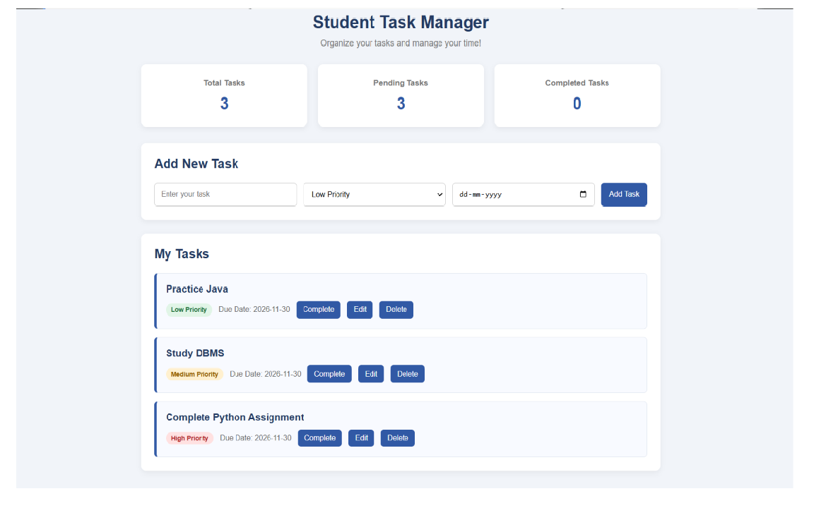

# Student Task Manager

A responsive web application built to help students organize their daily tasks, manage priorities, track deadlines, and monitor task completion.

## Features

- Add new tasks with title, priority, and due date.
- View all added tasks.
- Edit existing tasks.
- Delete tasks.
- Mark tasks as completed or pending.
- Dashboard displaying total, pending, and completed tasks.
- Different priority levels: Low, Medium, and High.
- Store task details using SQLite database.

## Technologies Used

- **Frontend:** HTML, CSS, JavaScript
- **Backend:** Python, Flask
- **Database:** SQLite
- **Tools:** VS Code, Git, GitHub

## Project Structure

```text
Student_Task_Manager/
├── app.py
├── README.md
├── .gitignore
├── templates/
│   └── index.html
├── static/
│   ├── style.css
│   └── script.js
└── screenshots/
    └── dashboard.png
```

## Application Screenshot



## How to Run the Project

1. Clone the repository:

   ```bash
   git clone https://github.com/akshithayekabote-cmd/Student_Task_Manager.git
   ```

2. Navigate to the project folder:

   ```bash
   cd Student_Task_Manager
   ```

3. Create a virtual environment:

   ```bash
   py -m venv venv
   ```

4. Activate the environment:

   ```bash
   .\venv\Scripts\Activate.ps1
   ```

5. Install Flask:

   ```bash
   pip install Flask
   ```

6. Start the application:

   ```bash
   python app.py
   ```

7. Open your browser:

   `http://127.0.0.1:5000`

## Database

SQLite is used to store task information. The database file is automatically created when the application runs.

## Purpose

This project was developed to gain practical experience in full-stack web development, Python programming, database connectivity, and CRUD operations.